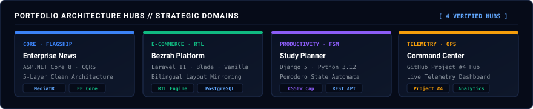
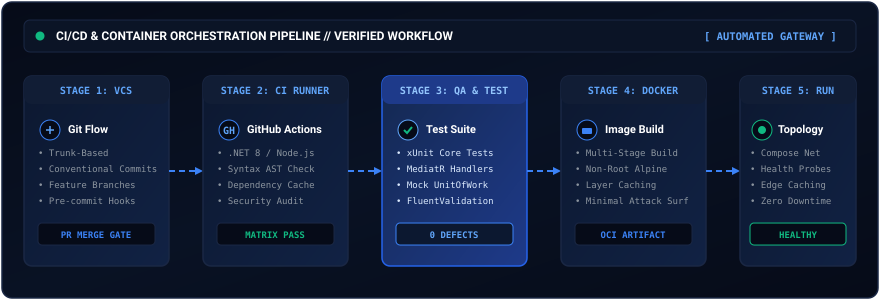
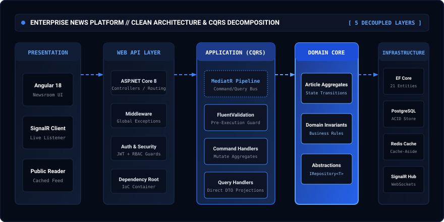
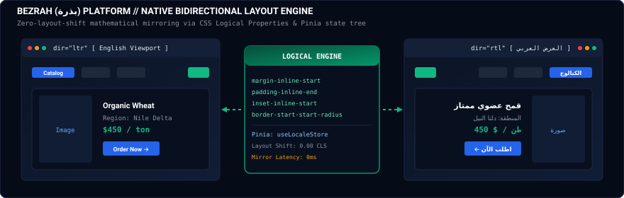
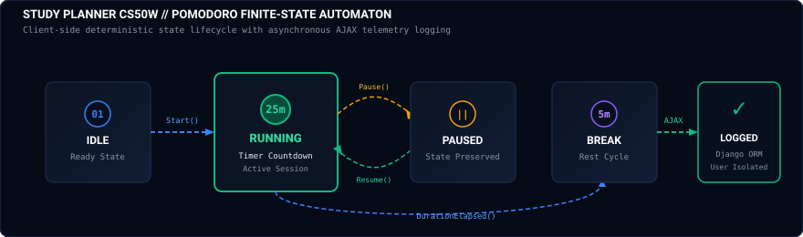
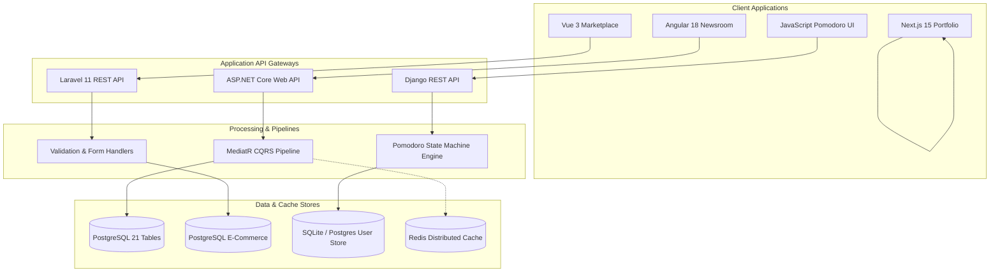
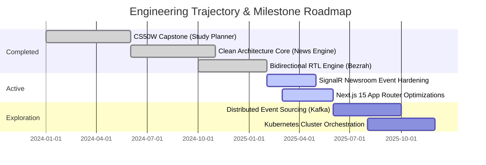

<div align="center">


<br />



<br />

# Omar Emad Ahmed
### **Software Systems Architect · Full-Stack Engineer · Systems Designer**

[](https://github.com/omaremadahmed)
[](https://github.com/omaremadahmed?tab=projects)
[](./analytics/index.html)
[](./docs/SYSTEMS_ANALYSIS_HUB.md)
[](https://www.linkedin.com/in/omar-emad-90b242401)
[](mailto:omargls600@gmail.com)

*Second-year Business Information Systems student at Helwan University bridging business domain modeling with high-integrity software architecture, Clean Architecture, CQRS, and resilient full-stack systems.*

<br />


</div>

<br />

---

## 📑 Table of Contents

| # | Section | Focus Area |
|:---:|:---|:---|
| **01** | [Professional Identity & Introduction](#1-professional-identity--introduction) | Core positioning, academic alignment, and technical foundation |
| **02** | [Profile Navigation & Architecture](#2-profile-navigation--architecture) | Operational map of repositories, hubs, and tools |
| **03** | [Engineering Philosophy & Principles](#3-engineering-philosophy--principles) | Chess-inspired maxims, defensive design, and domain boundaries |
| **04** | [Technical Domains Overview](#4-technical-domains-overview) | 7 specialized engineering focus areas |
| **05** | [Programming Language Matrix](#5-programming-language-matrix) | Type systems, runtimes, and practical project applications |
| **06** | [Frontend Engineering Stack](#6-frontend-engineering-stack) | Modern reactive interfaces, SSR/SSG, and state trees |
| **07** | [Backend Engineering Stack](#7-backend-engineering-stack) | Enterprise runtimes, Web APIs, and service pipelines |
| **08** | [Databases & Data Management](#8-databases--data-management) | Relational modeling, indexing, ACID transactions, and caching |
| **09** | [REST APIs & System Integrations](#9-rest-apis--system-integrations) | Contract design, WebSockets, idempotency, and status codes |
| **10** | [Software Architecture](#10-software-architecture) | Clean Architecture, CQRS, MediatR, and Domain-Driven Design |
| **11** | [SOLID Principles & Design Patterns](#11-solid-principles--design-patterns) | Architectural principles and GoF behavioral/creational patterns |
| **12** | [Data Structures & Algorithms](#12-data-structures--algorithms) | Computational efficiency, state automata, and algorithmic trade-offs |
| **13** | [Networking & Infrastructure](#13-networking--infrastructure) | OSI/TCP models, HTTP/1.1–HTTP/2 lifecycle, and socket connections |
| **14** | [Linux & Operating Systems](#14-linux--operating-systems) | POSIX environments, shell scripting, permissions, and systemd |
| **15** | [DevOps & CI/CD](#15-devops--cicd) | Automated validation pipelines, build automation, and linting |
| **16** | [Cloud Engineering](#16-cloud-engineering) | Deployment topologies, edge delivery, and cloud infrastructure |
| **17** | [Docker & Containerization](#17-docker--containerization) | Multi-stage image builds, volume orchestration, and Compose topologies |
| **18** | [Mobile Development](#18-mobile-development) | Responsive-first viewport engineering and cross-platform UI |
| **19** | [UI/UX & Design Systems](#19-uiux--design-systems) | Mathematical typographic scales, accessibility, and RTL mirroring |
| **20** | [Security Engineering Practices](#20-security-engineering-practices) | RBAC, JWT validation, CSRF defense, and parameter sanitization |
| **21** | [Testing & Quality Assurance](#21-testing--quality-assurance) | Unit boundaries, validation behaviors, and regression defense |
| **22** | [Git & GitHub Workflows](#22-git--github-workflows) | Trunk-based branches, conventional commits, and pull requests |
| **23** | [Engineering Documentation](#23-engineering-documentation) | Architectural Decision Records (ADRs) and living documentation |
| **24** | [Featured Flagship Project](#24-featured-flagship-project) | Enterprise News Platform: Clean Architecture & CQRS deep dive |
| **25** | [Additional Project Portfolio](#25-additional-project-portfolio) | Bezrah, Study Planner, Portfolio App, and House Platform |
| **26** | [Architecture Diagrams](#26-architecture-diagrams) | Rendered Mermaid schematics of execution pipelines |
| **27** | [Technology & Project Relationships](#27-technology--project-relationships) | Inter-dependency mapping across repos and infrastructure |
| **28** | [Verified GitHub Activity & Telemetry](#28-verified-github-activity--telemetry) | Live stats, contribution velocity, and language distribution |
| **29** | [Engineering Roadmap](#29-engineering-roadmap) | Completed foundations, active deliverables, and future explorations |
| **30** | [Current Development Focus](#30-current-development-focus) | Distributed consensus, message queues, and Kubernetes |
| **31** | [Central GitHub Project Integration](#31-central-github-project-integration) | Software Architecture & Engineering Command Center |
| **32** | [Analytics Dashboard Integration](#32-analytics-dashboard-integration) | Real-time data visualization engine and API caching |
| **33** | [Professional Links](#33-professional-links) | LinkedIn, repositories, and documentation mirrors |
| **34** | [Contact Information](#34-contact-information) | Verified email, communication standards, and timezones |
| **35** | [Technical Documentation Navigation](#35-technical-documentation-navigation) | Full index of architecture READMEs and systems analyses |

<div align="center">

</div>

## 1. Professional Identity & Introduction

I am an independent software engineer and second-year Business Information Systems (BIS) student at Helwan University in Cairo, Egypt. My technical trajectory bridges two complementary disciplines:

1. **Information Systems & Business Domain Analysis:** The formal study of organizational data flows, relational schema normalization, enterprise processes, accounting ledgers, and functional requirements.
2. **Software Architecture & Full-Stack Systems Design:** The practical implementation of resilient backends, decoupled domain cores, real-time message brokers, and bidirectional frontend user interfaces.

I treat software engineering not as an ad-hoc collection of scripts, but as a deliberate discipline of boundary enforcement, defensive validation, and strategic trade-off analysis. My work spans from C# and ASP.NET Core Clean Architecture solutions to Vue 3 and Next.js 15 web applications, backed by relational databases and containerized infrastructure.

<div align="center">

</div>

## 2. Profile Navigation & Architecture

This repository (`omaremadahmed/omaremadahmed`) functions as the root hub of my engineering presence. The public portfolio is organized across three integrated tiers:

<div align="center">

</div>

<br />

```
[ Tier 1: Public Profile README ] <── (You are here)
    ├── High-level architectural summaries
    ├── Verified repository matrices
    └── Live telemetry and operational roadmap
         │
         ├──► [ Tier 2: Specialized Architecture Documentation (docs/) ]
         │       ├── ENTERPRISE_NEWS_PLATFORM_README.md (5-layer Clean Arch spec)
         │       ├── BEZRAH_PLATFORM_README.md (Bilingual RTL engine spec)
         │       ├── STUDY_PLANNER_README.md (Finite-state machine spec)
         │       ├── PORTFOLIO_APP_README.md (React 19 Server Components spec)
         │       ├── HOUSE_PLATFORM_README.md (Modular monolith enterprise base)
         │       ├── SYSTEMS_ANALYSIS_HUB.md (Cross-system trade-off analysis)
         │       └── PROJECT_COMMAND_CENTER_SETUP.md (Project blueprint & views)
         │
         └──► [ Tier 3: Operational Tools & Applications ]
                 ├── GitHub Project: Software Architecture & Engineering Command Center
                 ├── Live Analytics Dashboard: analytics/index.html
                 └── Browser Theme: omar-github-dark-luxury.user.css
```

<div align="center">

</div>

## 3. Engineering Philosophy & Principles

> *"Strategy without tactics is the slowest route to victory. Tactics without strategy is the noise before defeat."* — Sun Tzu

My engineering philosophy is rooted in strategic discipline:

* **Predictability Over Cleverness:** A boring, explicit architecture with strict domain boundaries is vastly superior to a complex, implicit abstraction. Code is read ten times more often than it is written.
* **Defensive Boundary Discipline:** Never trust client-supplied input. Every external boundary (HTTP controllers, message subscribers, file parsers) must enforce strict type guards and pre-execution validation before invoking the domain layer.
* **Separation of Read and Write Concerns:** Transactional mutations demand strict validation, aggregate invariant checks, and relational integrity. Read queries demand projection speed, minimal join overhead, and aggressive caching.
* **Bidirectional Layout as a First-Class Citizen:** In bilingual applications, Arabic (RTL) is never an afterthought or an appended stylesheet. It is engineered from day one using CSS Logical Properties with mathematical symmetry.
* **Pragmatic Complexity Horizon:** Premature distributed microservices introduce distributed transactions, partial failures, and network latency. I favor disciplined modular monoliths with explicit boundaries that can be decomposed into services only when organizational scale demands it.

<div align="center">

</div>

## 4. Technical Domains Overview

| Domain | Focus Areas & Engineering Scope | Primary Realized Projects |
|:---|:---|:---|
| **Software Architecture** | Clean Architecture, CQRS, Domain-Driven Design, MediatR pipeline behaviors, Unit of Work, Repository Pattern | `enterprise-news-platform`, `House Platform` |
| **Full-Stack Engineering** | End-to-end web engineering, client-server contract synchronization, asynchronous job workflows | `bezrah-platform`, `study-planner-cs50w` |
| **Frontend Engineering** | Reactive component hierarchies, SSR/SSG, React Server Components, state tree management (Pinia, React Context) | `portfolio-app`, `bezrah-platform` |
| **Backend & APIs** | RESTful resource design, WebSockets (SignalR), middleware pipelines, exception formatting | `enterprise-news-platform`, `bezrah-platform` |
| **Databases & Caching** | Relational schema design (3NF), Entity Framework Core, PostgreSQL, SQLite, Redis cache-aside | `enterprise-news-platform`, `study-planner-cs50w` |
| **DevOps & Containers** | Docker multi-stage builds, Docker Compose network topologies, Linux server administration, CI/CD | All public projects, `House Platform` |
| **UI/UX & Localization** | CSS Logical Properties, typographic scaling, Figma design systems, bidirectional Arabic/English UX | `bezrah-platform`, `portfolio-app` |

---

## 5. Programming Language Matrix

| Language | Paradigm & Version | Runtime & Ecosystem | Practical Application in My Codebase |
|:---|:---|:---|:---|
| **C#** | Statically typed, OOP, Functional features (`C# 12`) | `.NET 8 SDK`, ASP.NET Core, CLR | Flagship enterprise publishing engine, MediatR command handlers, EF Core entity models |
| **TypeScript** | Statically typed, Strict Mode (`TS 5.x`) | Node.js, V8, Next.js 15, Angular 18 | Type-safe portfolio contracts, strict interface schemas, Angular reactive controllers |
| **JavaScript** | Dynamic, ES2022+ standards | Browser V8 / SpiderMonkey, Node.js | Client-side finite state machines, AJAX DOM updating, Pomodoro session timers |
| **Python** | Multi-paradigm, Dynamic (`Python 3.11+`) | CPython, Django, Celery | Academic productivity platform, Celery asynchronous background queues, ORM queries |
| **PHP** | Server-side OOP (`PHP 8.2+`) | PHP-FPM, Laravel 11 framework | Agricultural marketplace REST API, token authentication, request validation |
| **SQL** | Declarative Data Definition & Querying | PostgreSQL, SQLite | 21-table normalized schema design, foreign keys, index optimization, constraints |

---

## 6. Frontend Engineering Stack

```
[ User Interaction & Viewport ]
       │
       ├──► Next.js 15 (App Router, React Server Components, Streaming SSR)
       ├──► React 19 (Component architecture, Hooks, Client Islands)
       ├──► Angular 18 (Enterprise admin consoles, RxJS observables, TypeScript)
       ├──► Vue 3 (Composition API, Pinia state stores, Vite HMR tooling)
       └──► Styling & Layout: Tailwind CSS, CSS Logical Properties, Vanilla CSS Tokens
```

* **React 19 & Next.js 15:** Implemented in [`portfolio-app`](https://github.com/omaremadahmed/portfolio-app) leveraging React Server Components for zero-bundle-size initial page loads, paired with localized client islands.
* **Vue 3 & Pinia:** Implemented in [`bezrah-platform`](https://github.com/omaremadahmed/bezrah-platform) utilizing the Composition API for modular logic reuse and Pinia stores for global cart and authentication state.
* **Angular 18:** Implemented for enterprise editorial newsroom management in [`enterprise-news-platform`](https://github.com/omaremadahmed/enterprise-news-platform).

---

## 7. Backend Engineering Stack

* **ASP.NET Core 8:** High-throughput modular web API runtime. Implements custom middleware for global exception handling, correlation ID tracking, and RFC 7807 Problem Details formatting.
* **Django & Django REST Framework:** Robust Python web framework utilized in [`study-planner-cs50w`](https://github.com/omaremadahmed/study-planner-cs50w) and [`House Platform`](./docs/HOUSE_PLATFORM_README.md) for rapid domain modeling and authenticated REST endpoints.
* **Laravel 11:** Modern PHP web framework providing declarative routing, dependency injection containers, and database migration tooling for [`bezrah-platform`](https://github.com/omaremadahmed/bezrah-platform).
* **Node.js / Express:** Utilized for lightweight script tooling, developer utilities, and local API mock environments.

---

## 8. Databases & Data Management

```
Relational (PostgreSQL, SQLite)              In-Memory (Redis)
┌─────────────────────────────────┐        ┌─────────────────────────────────┐
│ • 21-Table Normalized Schemas   │        │ • Cache-Aside Invalidation      │
│ • Foreign Key Cascade Guards    │        │ • SignalR Message Backplane     │
│ • Transaction Isolation (ACID)  │        │ • Session State Storage         │
│ • B-Tree Composite Indexes      │        │ • Distributed Locking Support   │
└─────────────────────────────────┘        └─────────────────────────────────┘
```

* **Relational Schema Design:** Explicit foreign key constraints, cascading delete prevention, composite unique indexes, and audit timestamps across 21 relational tables in the Enterprise News platform.
* **Object-Relational Mapping (ORM):** Entity Framework Core (fluent API configurations, migrations, change tracker optimization via `AsNoTracking()`) and Django ORM (filtered querysets).
* **Cache-Aside Caching:** Redis caching layer isolating database queries on read-heavy public news endpoints with deterministic key invalidation on article publish commands.

---

## 9. REST APIs & System Integrations

* **Contract-First Design:** Clear resource naming, nested URI hierarchy (`/api/v1/articles/{id}/revisions`), and JSON payload schema enforcement.
* **Real-Time WebSockets:** SignalR integration delivering live server-push events to connected editorial clients upon document status transitions.
* **HTTP Semantics & Error Contracts:** Consistent utilization of HTTP verbs (`GET`, `POST`, `PUT`, `PATCH`, `DELETE`) with standardized error responses:
  - `400 Bad Request` with structured FluentValidation failure dictionaries.
  - `401 Unauthorized` & `403 Forbidden` for role enforcement.
  - `404 Not Found` for nonexistent entity IDs.
  - `409 Conflict` for state machine concurrency collisions.

---

## 10. Software Architecture

### Clean Architecture & Dependency Inversion

```
  ┌─────────────────────────────────────────────────────────┐
  │                   Domain Layer (Core)                   │
  │     • Business Entities & Enums                         │
  │     • Domain Invariants & Exceptions                    │
  │     • Repository & Unit of Work Interfaces              │
  └──────────────────────────▲──────────────────────────────┘
                             │
  ┌──────────────────────────┴──────────────────────────────┐
  │                    Application Layer                    │
  │     • CQRS Commands & Queries (MediatR)                 │
  │     • FluentValidation Behaviors                        │
  │     • Data Transfer Objects (DTOs) & Mappings           │
  └──────────────────────────▲──────────────────────────────┘
                             │
  ┌──────────────────────────┴──────────────────────────────┐
  │            Infrastructure & Persistence Layer           │
  │     • Entity Framework Core 21 Relational Tables        │
  │     • PostgreSQL Context & Migrations                   │
  │     • Redis Cache Provider & SignalR Hubs               │
  └──────────────────────────▲──────────────────────────────┘
                             │
  ┌──────────────────────────┴──────────────────────────────┐
  │                      Web API Layer                      │
  │     • Minimal APIs / Controllers                        │
  │     • Middlewares (Exception, Correlation, Auth)        │
  └─────────────────────────────────────────────────────────┘
```

* **Domain Layer:** Contains zero external dependencies. Pure C# classes representing business concepts (Articles, Revisions, Categories).
* **Application Layer:** Orchestrates business operations via CQRS command handlers. No direct knowledge of EF Core or database connection strings.
* **Persistence & Infrastructure:** Concrete implementations of repositories, database contexts, Redis caching, and file storage.
* **Web API Layer:** Dependency injection composition root, request routing, and transport handling.

---

## 11. SOLID Principles & Design Patterns

* **Single Responsibility (SRP):** MediatR handlers handle exactly one command or query (`CreateArticleCommandHandler`, `GetArticleByIdQueryHandler`).
* **Open/Closed (OCP):** Behavior extension via pipeline middleware behaviors (ValidationBehavior, LoggingBehavior) without altering existing handler code.
* **Liskov Substitution (LSP):** Repository contracts (`IRepository<T>`) replaceable across memory and relational adapters without violating client expectations.
* **Interface Segregation (ISP):** Fine-grained interfaces (`IReadOnlyRepository<T>`, `IWriteRepository<T>`) preventing clients from depending upon unneeded mutation methods.
* **Dependency Inversion (DIP):** High-level application modules depend exclusively on domain abstractions, not low-level database drivers.
* **Design Patterns Applied:**
  - *Mediator Pattern:* Decoupling in-process messaging via MediatR.
  - *Repository & Unit of Work:* Encapsulating data access and managing transactional atomicity.
  - *State Machine Pattern:* Formal state transition verification for editorial workflows and Pomodoro cycles.
  - *Factory & Builder:* Complex test data generation and composite UI component creation.

---

## 12. Data Structures & Algorithms

* **Deterministic Finite-State Automata:** Designed and implemented for the Pomodoro productivity engine in [`study-planner-cs50w`](https://github.com/omaremadahmed/study-planner-cs50w), preventing invalid transitions (e.g. transitioning from `Paused` directly to `Break` without completing active session bounds).
* **Hierarchical Tree & Graph Traversal:** Category taxonomy and comment-reply threading structures in the Enterprise News platform utilizing recursive relational queries.
* **Hash-Based Lookup Structures:** In-memory caching dictionaries and hash sets utilized for O(1) permission validation and tag lookups.
* **Algorithmic Complexity Awareness:** Optimizing API response projection from O(N) database round-trips (avoiding N+1 query traps) to O(1) single-trip joined queries using EF Core `.Include()` and projection `.Select()`.

---

## 13. Networking & Infrastructure

* **Network Protocols:** Practical understanding of the OSI 7-layer stack, TCP handshake mechanisms, DNS resolution chains, and TLS 1.3 encryption handshakes.
* **HTTP Lifecycle:** Deep familiarity with HTTP/1.1 persistent connections, HTTP/2 multiplexing, connection upgrade lifecycles (WebSockets/SignalR), request header semantics, and CORS preflight negotiations.
* **Reverse Proxies:** Configuring Nginx reverse proxy routing, SSL termination, client payload limits, and gzip/brotli static asset compression.

---

## 14. Linux & Operating Systems

* **POSIX Environments:** Daily development and deployment execution within Linux distributions (Ubuntu Server, Debian).
* **Shell Engineering:** Bash automation scripts for deployment orchestration, environment configuration, database backups, and log inspection.
* **Process & Service Management:** Managing long-running web application processes via `systemd` unit files, daemon supervision, signal handling (`SIGTERM`/`SIGINT`), and system resource monitoring (`htop`, `netstat`, `journalctl`).

<div align="center">

</div>

## 15. DevOps & CI/CD

<div align="center">

</div>

<br />

* **Automated CI Pipelines:** GitHub Actions workflows executing automated lint checks, TypeScript strict compile tests, and unit test suites on pull requests.
* **Build Optimization:** Caching dependency directories (`~/.nuget`, `~/.npm`, `~/.cache/pip`) to reduce CI runner execution times.

<div align="center">

</div>

## 16. Cloud Engineering

* **Platform Topologies:** Deploying decoupled web applications to modern cloud hosting platforms (Vercel edge networks, VPS instances, container hosts).
* **Static Asset & Edge Distribution:** Distributing pre-rendered frontend assets and client bundles via global Edge CDNs for sub-100ms first contentful paint (FCP).
* **Environment Configuration:** Decoupling configuration from code using twelve-factor application methodology (`.env` files, environment variable injection, zero secret exposure).

---

## 17. Docker & Containerization

* **Multi-Stage Dockerfiles:** Drastically reducing production image attack surfaces and sizes by separating SDK build stages from minimal Alpine runtime environments:
  ```dockerfile
  # Build Stage
  FROM mcr.microsoft.com/dotnet/sdk:8.0 AS build
  WORKDIR /src
  COPY ["API/API.csproj", "API/"]
  RUN dotnet restore "API/API.csproj"
  COPY . .
  RUN dotnet publish "API/API.csproj" -c Release -o /app/publish /p:UseAppHost=false

  # Runtime Stage
  FROM mcr.microsoft.com/dotnet/aspnet:8.0-alpine AS final
  WORKDIR /app
  COPY --from=build /app/publish .
  ENTRYPOINT ["dotnet", "EnterpriseNews.API.dll"]
  ```
* **Docker Compose Topologies:** Orchestrating multi-container local development environments uniting web APIs, PostgreSQL databases, Redis caches, and background worker queues with isolated internal network bridges.

---

## 18. Mobile Development & Responsive UX

* **Viewport Adaptation:** Mobile-first responsive fluid grids engineered with CSS clamp functions and custom breakpoints (640px, 768px, 1024px, 1280px).
* **Touch-Friendly Hit Targets:** Ensuring minimum 44×44px interactive tap targets across navigation buttons, dropdown menus, and form inputs.
* **Cross-Device Performance:** Minimizing layout shifts (CLS < 0.05) through explicit image dimensioning and font-display swap strategies.

---

## 19. UI/UX & Design Systems

* **Bilingual Arabic/English Mirroring Engine:** In [`bezrah-platform`](https://github.com/omaremadahmed/bezrah-platform), layouts are mirrored with zero visual displacement using native CSS Logical Properties (`margin-inline-start`, `padding-inline-end`, `inset-inline-start`).
* **Design Token Architecture:** Cohesive design tokens implemented across our custom Stylus CSS Skin and applications:
  - Deep Navy Canvas: `#060b18`
  - Elevated Surface: `#0c1425`
  - Structural Border: `#1a2744`
  - Electric Blue Accent: `#3b82f6`
  - Radiant Blue Highlight: `#60a5fa`
  - Primary Text: `#e6edf3`
  - Muted Text: `#8b949e`
* **Typography:** Harmonious typographic scales pairing modern Latin sans-serifs (Inter, Outfit) with legible Arabic typography (Tajawal, Cairo).

---

## 20. Security Engineering Practices

* **Role-Based Access Control (RBAC):** Hierarchical permission enforcement across reader, editor, reviewer, and administrator roles.
* **JWT & Session Security:** Cryptographically signed tokens (HMAC SHA-256), `HttpOnly` and `SameSite=Strict` cookie flags, short expiration lifetimes with refresh token rotation.
* **CSRF Mitigation:** Anti-forgery token verification on all state-mutating requests across Django and ASP.NET Core controllers.
* **BOLA / IDOR Prevention:** Scoping every database query to the authenticated `request.user` aggregate, ensuring users cannot access or mutate records belonging to other tenants.
* **Defensive Parameterization:** 100% parameterized SQL queries via ORMs, eliminating SQL injection vulnerabilities.

---

## 21. Testing & Quality Assurance

* **Unit Testing Boundaries:** Testing business invariants and domain rules in isolation from database engines or network transports.
* **FluentValidation Test Coverage:** Validating that malformed payloads (empty article titles, invalid email formats, out-of-range numerical parameters) trigger explicit validation errors prior to handler entry.
* **Regression Defense:** Automated test execution on GitHub Actions ensuring new commits cannot break existing core flows.

---

## 22. Git & GitHub Workflows

* **Trunk-Based & Feature Branching:** Maintaining a stable `main` branch with isolated feature branches (`feat/`, `fix/`, `docs/`) for all iterative developments.
* **Conventional Commit Standards:** Enforcing semantic commit messaging (`feat:`, `fix:`, `refactor:`, `docs:`, `chore:`) for clear repository historical auditability.
* **Branch Protection & Code Review:** Clean pull request templates, squash-merge workflows, and strict change reviews.

---

## 23. Engineering Documentation Practices

* **Living Architectural Blueprints:** Comprehensive system documentation maintained directly alongside repository source code in `docs/`.
* **Architectural Decision Records (ADRs):** Formal documentation of key architectural choices, alternatives considered, and trade-off justifications.
* **Single Source of Truth:** Unifying cross-system analyses and database schematics inside [`docs/SYSTEMS_ANALYSIS_HUB.md`](./docs/SYSTEMS_ANALYSIS_HUB.md).

<div align="center">

</div>

## 24. Featured Flagship Project

### [Enterprise News Platform](https://github.com/omaremadahmed/enterprise-news-platform) — Clean Architecture & CQRS Publishing Engine

*An enterprise-structured editorial publication platform engineered for multi-role editorial lifecycles, auditable revision histories, and real-time newsroom synchronization.*

<div align="center">

</div>

<br />

#### Deep Architectural Highlights:
* **Decoupled 5-Tier Layers:** `Domain` ➔ `Application` ➔ `Persistence` ➔ `Infrastructure` ➔ `Web API`.
* **Relational Persistence:** 21 normalized relational tables covering articles, revisions, categories, tags, editorial reviews, media assets, and RBAC permissions.
* **Strict Publication Lifecycle:** Finite state machine managing article progression:
  $$\text{Draft} \longrightarrow \text{Pending Review} \longrightarrow \text{Approved} \longrightarrow \text{Published}$$
* **Real-Time Synchronization:** SignalR event broadcaster keeping newsroom editors synchronized across active revisions with zero page refresh required.
* **Performance:** Redis caching on read-heavy public endpoints yielding sub-20ms cached response times.
* **Stack:** `C#` · `ASP.NET Core 8` · `Angular 18` · `EF Core` · `PostgreSQL` · `Redis` · `SignalR` · `Docker`
* **Full Documentation:** 📖 [Full Architecture README](./docs/ENTERPRISE_NEWS_PLATFORM_README.md) · 📊 [Cross-System Analysis](./docs/SYSTEMS_ANALYSIS_HUB.md)

<div align="center">

</div>

## 25. Additional Project Portfolio

<table>
<tr>
<td width="50%" valign="top">

### [Bezrah (بذرة) Platform](https://github.com/omaremadahmed/bezrah-platform)
*Bilingual Agricultural Digital Marketplace*

- **Bidirectional UI Engine:** 100% native RTL/LTR mirroring with zero layout shift using CSS logical properties.
- **Frontend Architecture:** Vue 3 Composition API with modular Pinia store architecture.
- **Backend API:** Laravel REST API with strict form validation and multi-provider OAuth authentication.
- **Stack:** `Vue 3` · `Vite` · `Pinia` · `Laravel` · `PostgreSQL` · `Docker`
- 📖 [Architecture Specification](./docs/BEZRAH_PLATFORM_README.md)

</td>
<td width="50%" valign="top">

### [Study Planner CS50W](https://github.com/omaremadahmed/study-planner-cs50w)
*Academic Productivity Suite — Harvard CS50W Capstone*

- **Client State Machine:** Deterministic finite-state Pomodoro machine with pause/resume cycle accounting.
- **Data Isolation:** Strict user-isolated querysets preventing horizontal privilege escalation (BOLA/IDOR).
- **Asynchronous Sync:** Non-blocking AJAX session logging to SQLite/PostgreSQL historical ledger.
- **Stack:** `Python` · `Django` · `JavaScript` · `SQLite/PostgreSQL`
- 📖 [Architecture Specification](./docs/STUDY_PLANNER_README.md)

</td>
</tr>
<tr>
<td width="50%" valign="top">

### [Portfolio Web App](https://github.com/omaremadahmed/portfolio-app)
*Type-Safe Bilingual Engineering Portfolio*

- **Server Components:** Zero-bundle-size React Server Components paired with lightweight client islands.
- **Strict Type Safety:** 100% TypeScript strict-mode data contracts for portfolio manifests.
- **Instant Localization:** Client-side English/Arabic language switching with zero reload latency.
- **Stack:** `Next.js 15` · `React 19` · `TypeScript` · `Tailwind CSS`
- 📖 [Architecture Specification](./docs/PORTFOLIO_APP_README.md)

</td>
<td width="50%" valign="top">

### [House Platform](./docs/HOUSE_PLATFORM_README.md)
*Enterprise Multi-Domain Base Architecture (Architecture Base)*

- **Modular Monolith:** Domain boundary partitioning across academic coordination and transaction ledgers.
- **Async Processing:** Celery worker queues backed by Redis for heavy background batch operations.
- **Containerization:** Isolated multi-container `docker-compose` topology.
- **Stack:** `Django REST` · `React` · `PostgreSQL` · `Celery` · `Redis` · `Docker`
- 📖 [Architecture Specification](./docs/HOUSE_PLATFORM_README.md)

</td>
</tr>
</table>

<br />

#### 🔬 Bezrah Platform — Native Bidirectional Layout Engine

<div align="center">

</div>

<br />

#### 🔬 Study Planner CS50W — Pomodoro Finite-State Automaton

<div align="center">

</div>

<div align="center">

</div>

## 26. Architecture Diagrams

### Cross-System Data Flow & Persistence Architecture



---

## 27. Technology & Project Relationships

```
                     ┌───────────────────────────────┐
                     │          omaremadahmed        │
                     │    (Profile & Command Hub)    │
                     └───────────────┬───────────────┘
                                     │
         ┌───────────────────────────┼───────────────────────────┐
         │                           │                           │
         ▼                           ▼                           ▼
┌──────────────────┐       ┌──────────────────┐       ┌──────────────────┐
│ Enterprise News  │       │ Bezrah Platform  │       │  Study Planner   │
│ • C# / .NET 8    │       │ • Vue 3 / Pinia  │       │ • Python / Django│
│ • Clean Arch     │       │ • Laravel 11 API │       │ • State Machine  │
│ • CQRS / EF Core │       │ • RTL Engine     │       │ • CS50W Capstone │
└────────┬─────────┘       └────────┬─────────┘       └────────┬─────────┘
         │                          │                          │
         └──────────────────────────┼──────────────────────────┘
                                    │
                                    ▼
                     ┌───────────────────────────────┐
                     │     Shared Engineering Core   │
                     │ • Relational Integrity (Postgres)
                     │ • Dockerized Environments     │
                     │ • Clean Boundary Discipline   │
                     └───────────────────────────────┘
```

---

## 28. Verified GitHub Activity & Telemetry

<div align="center">

| 📊 Systems & Activity Telemetry | 🛠 Core Languages & Distribution |
|:---:|:---:|
|  |  |

</div>

<br />

> 📈 **Live Analytics Application:** For interactive charts, dynamic repository explorers, and public telemetry metrics, visit the [Live Data Analytics Dashboard](./analytics/index.html).

---

## 29. Engineering Roadmap



---

## 30. Current Development Focus

My active technical exploration centers on distributed systems and enterprise infrastructure:

1. **Distributed Event-Driven Architecture:** Exploring Apache Kafka and RabbitMQ message brokers for asynchronous inter-service domain events.
2. **Kubernetes & Container Orchestration:** Deepening container lifecycle management, ingress controllers, ConfigMaps, and rolling deployment strategies.
3. **High-Performance C# Runtime Internals:** Investigating memory allocation ergonomics with `Span<T>`, `Memory<T>`, and zero-allocation JSON serialization in .NET 8.

---

## 31. Central GitHub Project Integration

My independent projects and architecture deliverables are organized into a single operational project hub:

🎯 **[Software Architecture & Engineering Command Center](https://github.com/omaremadahmed?tab=projects)**

* **View 1: 🗺️ Executive Roadmap:** High-level timeline table tracking deliverables across all 5 systems.
* **View 2: 🏗️ Architecture Pipeline:** Kanban board moving items from `Backlog` ➔ `Architecture Spec` ➔ `In Implementation` ➔ `Code Review` ➔ `Completed / Hardened`.
* **View 3: 🌐 Domain Matrix:** Deliverables partitioned by engineering discipline.
* **View 4: 📈 Insights & Analytics:** Real-time charts measuring architectural complexity distribution.

*Detailed configuration and card blueprints are documented in [`docs/PROJECT_COMMAND_CENTER_SETUP.md`](./docs/PROJECT_COMMAND_CENTER_SETUP.md).*

---

## 32. Analytics Dashboard Integration

To provide real, functional engineering telemetry without static graphics, I developed a dedicated single-page analytics application:

📊 **[Live Data Analytics Dashboard](./analytics/index.html)**

* **Live Data Retrieval:** Consumes the public GitHub REST API (`/users/omaremadahmed` and `/users/omaremadahmed/repos`).
* **Zero Dependencies:** Pure vanilla JavaScript (ES6+), HTML5, and CSS tokens matching our Dark Luxury identity.
* **Intelligent Rate Limiting:** Client-side 15-minute `localStorage` cache respecting GitHub's unauthenticated 60 requests/hour threshold.
* **Interactive Views:** Filterable repository explorer, primary language distribution charts, and domain mapping cards.
* *Architecture and deployment guide documented in [`analytics/README.md`](./analytics/README.md).*

---

## 33. Professional Links

* **GitHub Profile:** [`github.com/omaremadahmed`](https://github.com/omaremadahmed)
* **LinkedIn:** [`linkedin.com/in/omar-emad-90b242401`](https://www.linkedin.com/in/omar-emad-90b242401)
* **Email:** [`omargls600@gmail.com`](mailto:omargls600@gmail.com)
* **Engineering Command Center:** [`github.com/omaremadahmed?tab=projects`](https://github.com/omaremadahmed?tab=projects)
* **Systems Analysis Hub:** [`docs/SYSTEMS_ANALYSIS_HUB.md`](./docs/SYSTEMS_ANALYSIS_HUB.md)

---

## 34. Contact Information & Communication Standards

* **Inquiries:** Available for software architecture discussions, systems engineering collaborations, and full-stack technical projects.
* **Primary Channel:** [omargls600@gmail.com](mailto:omargls600@gmail.com)
* **Location & Timezone:** Cairo, Egypt · Eastern European Time (EET / UTC+2)
* **Communication Standard:** Clear, structured, and technically precise.

---

## 35. Technical Documentation Navigation

| Document | Primary Focus | Path |
|:---|:---|:---|
| **Enterprise News Platform Spec** | 5-Layer Clean Architecture, CQRS, MediatR, SignalR, 21 Tables | [`docs/ENTERPRISE_NEWS_PLATFORM_README.md`](./docs/ENTERPRISE_NEWS_PLATFORM_README.md) |
| **Bezrah Platform Spec** | Bidirectional RTL/LTR mirroring engine, Vue 3, Pinia, Laravel API | [`docs/BEZRAH_PLATFORM_README.md`](./docs/BEZRAH_PLATFORM_README.md) |
| **Study Planner Spec** | Pomodoro finite-state machine, user data isolation, CS50W Capstone | [`docs/STUDY_PLANNER_README.md`](./docs/STUDY_PLANNER_README.md) |
| **Portfolio App Spec** | Next.js 15 App Router, React 19 Server Components, Strict TypeScript | [`docs/PORTFOLIO_APP_README.md`](./docs/PORTFOLIO_APP_README.md) |
| **House Platform Spec** | Modular monolith architecture base, transaction ledgers, Celery queues | [`docs/HOUSE_PLATFORM_README.md`](./docs/HOUSE_PLATFORM_README.md) |
| **Systems Analysis Hub** | Cross-system comparison matrix, ADRs, database schematics, trade-offs | [`docs/SYSTEMS_ANALYSIS_HUB.md`](./docs/SYSTEMS_ANALYSIS_HUB.md) |
| **Project Setup & Insights Blueprint** | GitHub Projects v2 views, custom fields, and Insights chart configuration | [`docs/PROJECT_COMMAND_CENTER_SETUP.md`](./docs/PROJECT_COMMAND_CENTER_SETUP.md) |
| **Analytics Dashboard Guide** | Live GitHub API data engine, caching architecture, and setup | [`analytics/README.md`](./analytics/README.md) |

<div align="center">

</div>

<div align="center">

[](https://github.com/omaremadahmed?tab=projects)
[](./analytics/index.html)
[](./docs/SYSTEMS_ANALYSIS_HUB.md)

<br />



</div>
