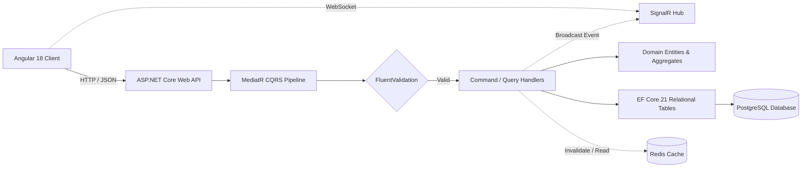

  

# Omar Emad Ahmed
### **Software Systems Architect · Full-Stack Engineer · Systems Design**

*Second-year Business Information Systems student bridging enterprise business analysis with robust software architecture, Clean Architecture, and high-integrity web applications.*

 

 

## ⚡ Engineering Command Center Telemetry

| 📊 Systems & Activity Telemetry | 🛠 Core Languages & Distribution |
|:---:|:---:|
|  |  |

 

> 🎮 **Central Engineering Hub:** View the live Kanban boards, architecture milestones, and delivery pipelines on the [Software Architecture & Engineering Command Center](https://github.com/omaremadahmed?tab=projects). Complete cross-system schematics and trade-offs are documented in the [Systems Analysis & Engineering Insights Hub](./docs/SYSTEMS_ANALYSIS_HUB.md).

---

## ♞ Architectural Doctrines & Engineering Principles

> *"Every system is an intentional game of strategy — disciplined openings, structured middlegame, predictable endgame."*

<table>
<tr>
<td width="50%" valign="top">

### 🛡️ Defensive Engineering
- **Strict Boundary Validation:** Input payloads verified via FluentValidation and typed contracts prior to domain execution.
- **Relational Integrity:** Explicit foreign key constraints, cascading policies, and ACID transactions across all relational stores.
- **Auditable Lifecycles:** Temporal tracking, revision tables, and structured audit logs for every state transition.

</td>
<td width="50%" valign="top">

### ⚡ CQRS & Async Decoupling
- **Segregated Pipelines:** Write-heavy command pipelines separated from read-heavy projected queries.
- **Real-Time Distribution:** Event broadcasting via SignalR and Redis pub/sub backplanes for active multi-client sync.
- **Cache-Aside Strategies:** Granular invalidation patterns across high-volume read surfaces.

</td>
</tr>
<tr>
<td width="50%" valign="top">

### 🌐 First-Class Bidirectional UX
- **Zero-Drift Mirroring:** Native Arabic (RTL) and English (LTR) layout engines using CSS Logical Properties.
- **Mathematical Sizing:** Typographic scale alignment ensuring identical visual balance between Arabic and Latin letterforms.
- **Atomic State Trees:** Centralized Pinia and React localized state avoiding layout flicker.

</td>
<td width="50%" valign="top">

### 📐 Modular Monolith to Microservices
- **Domain-Driven Cohesion:** Modules partitioned by business bounded contexts, avoiding premature distributed complexity.
- **Dependency Inversion:** Outer transport and database adapters strictly depend upon inner domain contracts.
- **Service-Ready Partitioning:** Clear boundary definitions enabling eventual containerized service extraction.

</td>
</tr>
</table>

---

## ♛ Flagship Engineering Spotlight

### [Enterprise News Platform](https://github.com/omaremadahmed/enterprise-news-platform) — Clean Architecture & CQRS Engine

*An enterprise-structured editorial and news publication platform engineered for multi-role workflows, content auditing, and real-time newsroom distribution.*

 

#### System Specifications:
- **Architecture:** Clean Architecture across five decoupled layers (`Domain` ➔ `Application` ➔ `Infrastructure` ➔ `Persistence` ➔ `API`).
- **Data Persistence:** PostgreSQL with 21 relational tables (Articles, Revisions, Categories, Tags, Editorial Reviews, Media Assets, RBAC).
- **Publication Lifecycle:** State-machine transitions: `Draft` ➔ `PendingReview` ➔ `Approved` ➔ `Published`.
- **Concurrency & Events:** SignalR real-time event broadcaster keeping newsroom editors synchronized across active drafts.
- **Stack:** `C#` · `ASP.NET Core 8` · `Angular 18` · `Entity Framework Core` · `PostgreSQL` · `Redis` · `SignalR` · `Docker`
- **Documentation:** 📖 [Full Architecture Specification](./docs/ENTERPRISE_NEWS_PLATFORM_README.md) · 📊 [Cross-System Analysis](./docs/SYSTEMS_ANALYSIS_HUB.md)

---

## ♜ Engineered Systems Portfolio

<table>
<tr>
<td width="50%" valign="top">

### [Bezrah (بذرة) Platform](https://github.com/omaremadahmed/bezrah-platform)
*Bilingual Agricultural Digital Marketplace*

- **Bidirectional UX:** 100% native RTL/LTR mirroring with zero layout shift using CSS logical properties.
- **Frontend Core:** Vue 3 Composition API with modular Pinia store architecture.
- **Backend API:** Laravel REST API with strict form validation and multi-provider authentication.
- **Stack:** `Vue 3` · `Vite` · `Pinia` · `Laravel` · `PostgreSQL` · `Docker`
- 📖 [Architecture Specification](./docs/BEZRAH_PLATFORM_README.md)

</td>
<td width="50%" valign="top">

### [Study Planner CS50W](https://github.com/omaremadahmed/study-planner-cs50w)
*Academic Productivity Suite — Harvard CS50W Capstone*

- **Client State Machine:** Deterministic finite-state Pomodoro machine with pause/resume cycle accounting.
- **Data Isolation:** Strict user-isolated querysets preventing horizontal privilege escalation (BOLA/IDOR).
- **Asynchronous Sync:** Non-blocking AJAX session logging to SQLite/PostgreSQL historical ledger.
- **Stack:** `Python` · `Django` · `JavaScript` · `SQLite/PostgreSQL`
- 📖 [Architecture Specification](./docs/STUDY_PLANNER_README.md)

</td>
</tr>
<tr>
<td width="50%" valign="top">

### [Portfolio Web App](https://github.com/omaremadahmed/portfolio-app)
*Type-Safe Bilingual Engineering Portfolio*

- **Server Components:** Zero-bundle-size React Server Components paired with lightweight client islands.
- **Strict Type Safety:** 100% TypeScript strict-mode data contracts for portfolio manifests.
- **Instant Localization:** Client-side English/Arabic language switching with zero reload latency.
- **Stack:** `Next.js 15` · `React 19` · `TypeScript` · `Tailwind CSS`
- 📖 [Architecture Specification](./docs/PORTFOLIO_APP_README.md)

</td>
<td width="50%" valign="top">

### [House Platform](./docs/HOUSE_PLATFORM_README.md)
*Enterprise Multi-Domain Base Architecture*

- **Modular Monolith:** Domain boundary partitioning across academic coordination and transaction ledgers.
- **Async Processing:** Celery worker queues backed by Redis for heavy background batch operations.
- **Containerization:** Isolated multi-container `docker-compose` topology.
- **Stack:** `Django REST` · `React` · `PostgreSQL` · `Celery` · `Redis` · `Docker`
- 📖 [Architecture Specification](./docs/HOUSE_PLATFORM_README.md)

</td>
</tr>
</table>

---

## ♝ Technology Radar & Engineering Competencies

<table>
<tr>
<td><b>Backend & Systems</b></td>
<td>

</td>
</tr>
<tr>
<td><b>Frontend & Interfaces</b></td>
<td>

</td>
</tr>
<tr>
<td><b>Data & Messaging</b></td>
<td>

</td>
</tr>
<tr>
<td><b>DevOps & Infrastructure</b></td>
<td>

</td>
</tr>
<tr>
<td><b>Architectural Patterns</b></td>
<td>

</td>
</tr>
</table>

---

## 🎓 Academic Foundation & Coursework

- **B.Sc. in Business Information Systems (BIS)** · *Helwan University (Current, 2nd Year)*
  - Core curriculum: Systems Analysis & Design, Database Management Systems, Data Structures, Business Process Modeling, Enterprise Information Architecture.
- **CS50W: Web Programming with Python and JavaScript** · *Harvard Online*
  - Comprehensive capstone project engineering: [`study-planner-cs50w`](https://github.com/omaremadahmed/study-planner-cs50w).

---

## 📬 Command Center Navigation & Contact

 

 

Architected with precision. Dark Navy & Electric Blue Engineering Identity © 2026 Omar Emad Ahmed.

