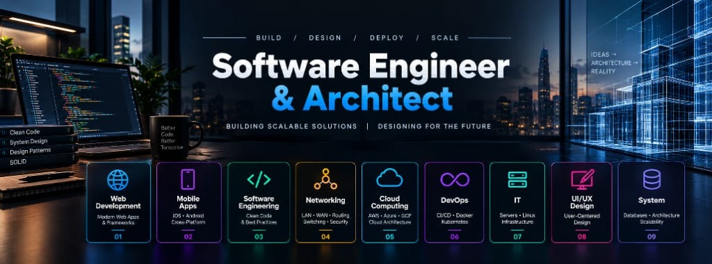

<div align="center">



<br />
<br />


# Omar Emad Ahmed
### Software Engineering | Software Architecture | Full-Stack Development | Systems Design

*Second-year Business Information Systems (BIS) student engineering resilient web architectures and scalable systems.*

<br />

[](https://www.linkedin.com/in/omar-emad-90b242401)
[](mailto:omargls600@gmail.com)
[](https://github.com/omaremadahmed)

<br />

```text
"Every line of code is a calculated move toward system stability, modularity, and long-term maintainability."
```

---

</div>

## ♟ Executive Overview

I am a second-year **Business Information Systems (BIS)** student focused on software engineering, distributed systems principles, and software architecture. My engineering approach balances disciplined analysis with pragmatic implementation: defining clear domain boundaries, evaluating trade-offs between performance and maintainability, and building robust full-stack applications.

<table width="100%">
<tr>
<td width="33%" valign="top">
<h4>🏛 Architecture & Systems</h4>
<p>Designing modular applications with clean separation of concerns, CQRS patterns, RESTful contracts, and normalized relational schemas.</p>
</td>
<td width="33%" valign="top">
<h4>⚡ Full-Stack Engineering</h4>
<p>Implementing responsive, bilingual interfaces with React, Next.js, and Vue 3, integrated with hardened backend services in Django and ASP.NET Core.</p>
</td>
<td width="33%" valign="top">
<h4>🎓 Academic Foundation</h4>
<p>Bridging enterprise workflow analysis, relational data integrity, and computer science foundations through university study and Harvard CS50 coursework.</p>
</td>
</tr>
</table>

---

## ♟ Strategic Engineering Workflow

My software development methodology follows a disciplined six-stage progression inspired by strategic calculation:

```text
[01 Opening]      Domain deconstruction, requirement modeling, and boundary analysis.
      │
[02 Development]  Relational schema design, API contract specifications, and component structure.
      │
[03 Calculation]  Evaluating trade-offs between performance, maintainability, and security.
      │
[04 Execution]    Implementation of type-safe frontend components, backend services, and containers.
      │
[05 Analysis]     Query optimization, state verification, error handling, and structured logging.
      │
[06 Refinement]   Code refactoring, interface documentation, and production readiness hardening.
```

---

## 🛠 Curated Technology Stack

<table width="100%">
<tr>
<td width="50%" valign="top">

### 💻 Programming Languages
- [](https://www.python.org/)
- [](https://www.typescriptlang.org/)
- [](https://developer.mozilla.org/en-US/docs/Web/JavaScript)
- [](https://learn.microsoft.com/en-us/dotnet/csharp/)
- [](https://en.wikipedia.org/wiki/SQL)
- [](https://en.wikipedia.org/wiki/C_(programming_language))
- [](https://developer.mozilla.org/en-US/docs/Web/HTML)
- [](https://developer.mozilla.org/en-US/docs/Web/CSS)

### ⚙ Backend & API Architecture
- [](https://www.djangoproject.com/)
- [](https://www.django-rest-framework.org/)
- [](https://dotnet.microsoft.com/)
- [](https://nodejs.org/)
- [](https://expressjs.com/)
- [](https://restfulapi.net/)
- [](https://jwt.io/)

</td>
<td width="50%" valign="top">

### 🎨 Frontend Engineering
- [](https://react.dev/)
- [](https://nextjs.org/)
- [](https://vuejs.org/)
- [](https://vitejs.dev/)
- [](https://tailwindcss.com/)
- [](https://pinia.vuejs.org/)
- [](#)

### 🗄 Databases & Persistence
- [](https://www.postgresql.org/)
- [](https://www.sqlite.org/)
- [](https://redis.io/)
- [](https://learn.microsoft.com/en-us/ef/core/)

### 🚀 DevOps, Cloud & Systems
- [](https://www.docker.com/)
- [](https://git-scm.com/)
- [](https://github.com/features/actions)
- [](https://www.kernel.org/)
- [](#)
- [](https://www.figma.com/)

</td>
</tr>
</table>

---

## 🏛 Core Engineering Capabilities

<table width="100%">
<tr>
<td width="50%" valign="top">
<h4>📐 Architecture & System Design</h4>
<ul>
<li><b>Modular Monoliths:</b> Structured service layers and domain boundaries to prevent tight coupling.</li>
<li><b>Clean Architecture:</b> Enforcing dependency inversion across Domain, Application, and Infrastructure layers.</li>
<li><b>CQRS Fundamentals:</b> Separating read pipelines from state-mutating command handlers via MediatR.</li>
<li><b>SOLID Principles:</b> Designing maintainable, testable, and extensible object-oriented systems.</li>
</ul>
</td>
<td width="50%" valign="top">
<h4>🔌 API Design & Data Integrity</h4>
<ul>
<li><b>RESTful Contracts:</b> Standardized HTTP status codes, structured error envelopes, and consistent schemas.</li>
<li><b>Relational Modeling:</b> 1NF–3NF normalization, foreign key constraints, and indexing strategies.</li>
<li><b>Authentication Lifecycles:</b> Secure JWT issuance, refresh token rotation, and Role-Based Access Control (RBAC).</li>
<li><b>Transaction Consistency:</b> Atomic database transactions ensuring ACID guarantees during financial workflows.</li>
</ul>
</td>
</tr>
<tr>
<td width="50%" valign="top">
<h4>🎨 Frontend Craft & State Flow</h4>
<ul>
<li><b>Bidirectional Layouts:</b> First-class Arabic (RTL) and English (LTR) design with dynamic DOM mirroring.</li>
<li><b>Reactive Stores:</b> Predictable client state management via Pinia, React Context, and modern hooks.</li>
<li><b>Type-Safe Interfaces:</b> Strict TypeScript interfaces matching backend response models.</li>
<li><b>Performance-First CSS:</b> Responsive grid architectures without unnecessary framework overhead.</li>
</ul>
</td>
<td width="50%" valign="top">
<h4>🛡 Operational & Security Mindset</h4>
<ul>
<li><b>Environment Isolation:</b> Strict isolation of production secrets, credentials, and configuration flags.</li>
<li><b>Containerization:</b> Reproducible Docker Compose environments for local development parity.</li>
<li><b>Defensive Input Validation:</b> Server-side sanitization, parameterized queries, and CORS configuration.</li>
<li><b>Technical Documentation:</b> Comprehensive architecture diagrams, setup guides, and API documentation.</li>
</ul>
</td>
</tr>
</table>

---

## 🚀 Featured Engineering Projects

<table width="100%">
<tr>
<td width="100%">

### 1. House Platform — Modular Enterprise Web Ecosystem `[Enterprise Base / Private]`
*A multi-domain web ecosystem integrating academic coordination, transaction ledgers, and commerce.*

- **Engineering Problem:** Coordinating multiple distinct business domains (academic management, simulated banking, and e-commerce) within a coherent platform without architectural coupling.
- **Architectural Solution:** Decoupled Django REST Framework backend with domain-isolated services; Vite React frontend with Context API; Celery task queue for asynchronous workflows; Redis session cache.
- **Key Modules:**
  - **Academic Hub (`edu`):** Student lifecycle tracking, institutional room coordination, and academic alliances.
  - **Economic Hub (`bank`):** Double-entry simulated transaction ledgers, account types, and merchant workflows.
  - **Marketplace & Security:** Product catalog browsing, session cart, rate limiting, and JWT authentication.
- **Technology Stack:** `Python` `Django REST Framework` `React` `PostgreSQL` `Celery` `Redis` `Docker`
- **Project Classification:** Independent Architecture & Enterprise Full-Stack Engineering Platform

</td>
</tr>
<tr>
<td width="100%">

### 2. [Enterprise News Platform — Clean Architecture & CQRS](https://github.com/omaremadahmed/enterprise-news-platform)
*An enterprise publishing and editorial platform engineered for structured, auditable workflows.*

[](https://github.com/omaremadahmed/enterprise-news-platform)

- **Engineering Problem:** Managing multi-stage editorial workflows with strict validation, event auditing, and real-time collaboration.
- **Architectural Solution:** Strict Clean Architecture across 5 layers (`Domain`, `Application`, `Infrastructure`, `Persistence`, `API`); MediatR command and query handlers; FluentValidation pipeline behaviors; Entity Framework Core with 21 relational tables; SignalR real-time event broadcasting.
- **Key Capabilities:**
  - State machine news lifecycle: `Draft` → `PendingReview` → `Approved` → `Published`.
  - CQRS command separation with audit trails for all state changes.
  - SignalR real-time notification hub for concurrent editorial updates.
- **Technology Stack:** `C#` `ASP.NET Core` `Angular` `PostgreSQL` `Entity Framework Core` `Redis` `SignalR`
- **Project Classification:** Enterprise Backend Architecture & Distributed Workflow Platform

</td>
</tr>
<tr>
<td width="100%">

### 3. [Bezrah (بذرة) — Bilingual Agricultural E-Commerce Platform](https://github.com/omaremadahmed/bezrah-platform)
*A production-grade digital marketplace connecting regional growers with consumer and business markets.*

[](https://github.com/omaremadahmed/bezrah-platform)

- **Engineering Problem:** Solving awkward RTL adaptations in traditional commerce platforms while providing smooth product discovery and multi-channel inquiry pipelines.
- **Architectural Solution:** Native bidirectional architecture supporting seamless Arabic (RTL) and English (LTR) layout mirroring with tailored typography; Vue 3 Composition API; Pinia reactive stores; Laravel REST API backend with PostgreSQL.
- **Key Capabilities:**
  - Dynamic RTL/LTR layout switching with zero layout breaking.
  - Multi-provider authentication (Email/Password, Google OAuth, GitHub OAuth).
  - Role-based authorization for administrators, catalog managers, and commercial buyers.
- **Technology Stack:** `Vue 3` `Vite` `Pinia` `Laravel REST API` `PostgreSQL` `Vue I18n` `Docker-Ready`
- **Project Classification:** Bilingual Commerce & Reactive State Architecture

</td>
</tr>
<tr>
<td width="100%">

### 4. [Study Planner — Harvard CS50W Capstone Project](https://github.com/omaremadahmed/study-planner-cs50w)
*A customized academic productivity application designed to prevent burnout through structured intervals.*

[](https://github.com/omaremadahmed/study-planner-cs50w)

- **Engineering Problem:** Students frequently experience productivity degradation due to unstructured study sessions and lack of historical subject time tracking.
- **Architectural Solution:** Multi-app Django architecture (`planner`, `subjects`, `tasks`, `users`) with an asynchronous JavaScript state machine managing active Pomodoro intervals and persisting session metrics to SQLite.
- **Key Capabilities:**
  - Client-side timer state machine with asynchronous background synchronization.
  - Subject-level time budgeting and productivity analytics.
  - Strict user-isolated data boundaries and session authentication.
- **Technology Stack:** `Python` `Django` `JavaScript` `SQLite` `Responsive CSS Grid`
- **Project Classification:** Verified Harvard CS50W Capstone Coursework Project

</td>
</tr>
<tr>
<td width="100%">

### 5. [Strategic Engineering Portfolio — Next.js 15 App Architecture](https://github.com/omaremadahmed/portfolio-app)
*An interactive bilingual digital portfolio showcasing architectural systems and verified coursework.*

[](https://github.com/omaremadahmed/portfolio-app)

- **Engineering Problem:** Presenting multi-disciplinary engineering domains and academic evidence in a performant, type-safe web application with seamless Arabic/English switching.
- **Architectural Solution:** Next.js 15 App Router with React 19, strict TypeScript schemas, and modern glassmorphic styling tokens; dynamic RTL/LTR context provider.
- **Key Capabilities:**
  - Type-safe data models for projects, domains, and coursework in `/data`.
  - Floating glass dock navigation and responsive accordion drawers.
  - Complete client-side internationalization with bidirectional layout mirroring.
- **Technology Stack:** `Next.js 15` `React 19` `TypeScript` `Tailwind CSS` `Lucide React` `Vercel`
- **Project Classification:** Modern Frontend Architecture & Type-Safe Portfolio Application

</td>
</tr>
</table>

---

## 🏛 Nine Technical Domains of Focus

I organize my technical development across nine complementary disciplines, with **Software Engineering** and **Systems Engineering** serving as the architectural core:

| # | Technical Domain | Focus & Architectural Application | Role in Complete Systems |
| :---: | :--- | :--- | :--- |
| **01** | **Software Engineering** *(Core Focus)* | Algorithms, SOLID principles, design patterns, testing, refactoring, and clean code standards. | Provides foundational discipline and algorithmic reliability. |
| **02** | **Systems Engineering** *(Core Focus)* | Relational schema design, database normalization, scalability trade-offs, and data pipelines. | Ensures end-to-end data integrity and architectural coherence. |
| **03** | **Web Development** | Full-stack web architectures, RESTful API design, state management, and bidirectional UI. | Delivers user-facing functionality and enterprise workflow tools. |
| **04** | **Cloud Computing** | Cloud infrastructure fundamentals, compute/storage models, environment management. | Provides scalable compute, hosting, and distributed accessibility. |
| **05** | **DevOps** | Containerization with Docker, Git branching strategies, automated workflows, and Linux. | Guarantees reproducible builds and predictable release cycles. |
| **06** | **Networking** | OSI model, TCP/IP protocol suite, VLANs, subnetting, packet inspection, and network security. | Underpins client-server communications and secure transport. |
| **07** | **Information Technology (IT)** | Operating system internals, systems configuration, hardware diagnostics, and IT fundamentals. | Manages underlying runtime environments and infrastructure. |
| **08** | **Mobile Applications** | Responsive mobile architectures, cross-platform principles, and touch ergonomics. | Extends system accessibility to handheld and remote devices. |
| **09** | **UI/UX Design** | Figma design systems, wireframing, WCAG accessibility, and native Arabic RTL typography. | Translates complex functionality into intuitive, clear interfaces. |

---

## 🎯 Current Focus & Continuous Development

I am actively deepening my technical capabilities across several key engineering areas:

- **Architectural Patterns:** Expanding practical implementations of Clean Architecture, Domain-Driven Design (DDD), and Event-Driven messaging.
- **Cloud & Infrastructure:** Advancing container orchestration with Docker and building automated CI/CD deployment pipelines.
- **Data Engineering:** Optimizing PostgreSQL query execution plans, indexing strategies, and database connection pooling.
- **System Resilience:** Hardening input validation, automated regression testing, and structured application observability.

---

## 📜 Verified Coursework & Academic Credentials

- **Business Information Systems (BIS)** — *University Degree Program (2nd Year In Progress)*
  - Academic focus: Systems Analysis & Design, Database Management, Business Process Modeling, and Enterprise Information Architecture.
- **ICDL (International Computer Driving Licence)** — *Real Soft House Testing & Training Center* (Certified & Verified)
- **Harvard CS50x:** Introduction to Computer Science — *Harvard University / edX* (Completed Coursework)
- **Harvard CS50P:** Programming with Python — *Harvard University / edX* (Completed Coursework)
- **Harvard CS50W:** Web Programming with Python and JavaScript — *Harvard University / edX* (Completed Coursework)
- **Harvard CS50 SQL:** Introduction to Databases with SQL — *Harvard University / edX* (Completed Coursework)
- **Harvard CS50 Cybersecurity:** Introduction to Cybersecurity — *Harvard University / edX* (Completed Coursework)

---

## 📬 Connect with Me

<div align="center">

[](https://www.linkedin.com/in/omar-emad-90b242401)
[](mailto:omargls600@gmail.com)
[](https://github.com/omaremadahmed)

<br />

<sub>Designed with precision. Structured for maintainability. © Omar Emad Ahmed</sub>

</div>
