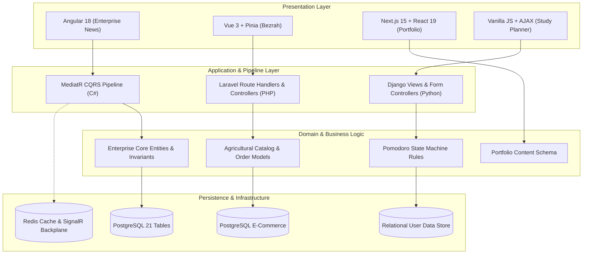
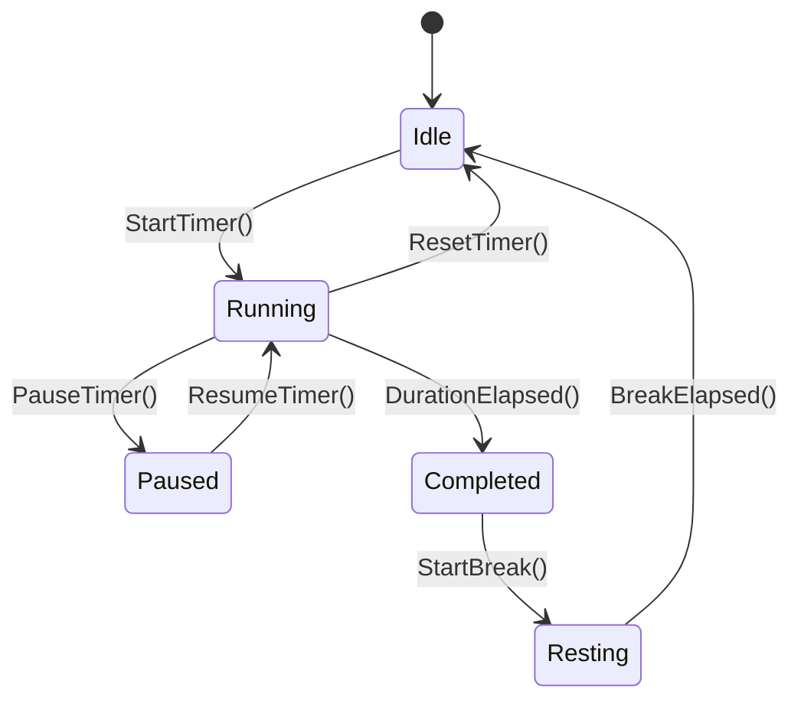

# Systems Analysis & Engineering Insights Hub

> **Centralized Architectural Analysis, System Schematics & Engineering Trade-Offs**  
> *Author:* Omar Emad Ahmed (`omaremadahmed`)  
> *Specialization:* Software Architecture · Systems Design · Full-Stack Engineering

---

## 1. Executive Systems Matrix

This hub unifies the technical architecture, data consistency guarantees, and structural trade-offs across all five engineered systems into a single source of truth.

| System | Primary Architectural Pattern | Core Stack | Data Persistence & State | Key Engineering Challenge |
|:---|:---|:---|:---|:---|
| **Enterprise News Platform** | Clean Architecture + CQRS | C# · ASP.NET Core 8 · Angular 18 | PostgreSQL (21 Tables) · Redis | Multi-stage editorial state machine with concurrent SignalR real-time broadcasts |
| **Bezrah (بذرة) Platform** | Decoupled Client-Server / Modular | Vue 3 · Pinia · Laravel REST API | PostgreSQL · Token Auth | Zero-layout-shift Arabic (RTL) and English (LTR) bidirectional visual mirroring |
| **Study Planner CS50W** | MVC with Client-Side State Machine | Python · Django · JavaScript | SQLite / PostgreSQL · User Isolation | Deterministic client-side Pomodoro state machine with asynchronous session auditing |
| **Portfolio Web App** | React Server Components + Hybrid | Next.js 15 · React 19 · TypeScript | Static / Edge Hydration | Type-safe localized state tree with zero runtime style recalculation |
| **House Platform** | Modular Monolith (Enterprise Base) | Django REST · React · Celery · Docker | PostgreSQL · Redis Queue | Multi-domain transactional ledger integrity and asynchronous background job pipelines |

---

## 2. Cross-System Architectural Comparison



### 2.1 Communication & Data Consistency Guarantees

| Dimension | Enterprise News | Bezrah Platform | Study Planner | House Platform |
|:---|:---|:---|:---|:---|
| **API Paradigm** | RESTful + SignalR WebSockets | RESTful JSON API | Session-authenticated AJAX | RESTful API + Celery Workers |
| **Data Consistency** | Strong (ACID across 21 entities) | Strong (Order & Inventory ACID) | Strong (User-isolated SQLite/Postgres) | Eventual across background queues |
| **Caching Layer** | Redis (Read-heavy categories) | Browser & HTTP Cache Headers | In-memory client cache | Redis (Task cache & session broker) |
| **Validation Contract** | FluentValidation pipeline behaviors | Laravel Request Form validation | Django Form & Model Cleaners | Django Serializer & Model validators |
| **Concurrency Model** | ASP.NET Core async/await thread pool | PHP-FPM worker processes | Python WSGI / Gunicorn threads | Celery asynchronous worker pool |

---

## 3. Deep Dive 1: Enterprise News Platform (Clean Architecture & CQRS)

### 3.1 Architectural Decomposition

The system strictly enforces the **Dependency Inversion Principle (DIP)** across five decoupled layers:

```
[ Domain Layer ]  <-- Independent of all external frameworks
       ▲
[ Application Layer ]  <-- Commands, Queries, MediatR Handlers, DTOs, FluentValidation
       ▲
[ Persistence Layer ]  <-- Entity Framework Core, 21 DbSets, Migrations, Repositories
       ▲
[ Infrastructure Layer ] <-- Redis Cache Provider, SignalR Hubs, External Email/Notification
       ▲
[ Web API Layer ]  <-- Controllers, Swagger, Middlewares, Dependency Injection Roots
```

### 3.2 CQRS Pipeline Behaviors

Every state-mutating command and read query flows through a deterministic MediatR pipeline:

1. **Incoming HTTP Request** ➔ Handled by Minimal API / Controller.
2. **Pre-Processor Validation Behavior** ➔ `FluentValidation` executes against the command payload before entering the handler. If validation fails, execution short-circuits with structured `ValidationProblemDetails`.
3. **Execution Pipeline** ➔ 
   - **Commands:** Mutate domain aggregates, update Entity Framework change tracker, persist via `IUnitOfWork.SaveChangesAsync()`.
   - **Queries:** Use `AsNoTracking()` projection directly to read-optimized DTOs for maximal read throughput.
4. **Post-Processor Events** ➔ Dispatches domain events to SignalR hubs (`EditorialHub`) notifying active editors of document state transitions.

### 3.3 Relational Schema Architecture (21 Relational Entities)

```
Users ──< UserRoles >── Roles
  │
  ├──< Articles >── ArticleTags ──< Tags
  │       │
  │       ├──< ArticleRevisions (Full Audit History)
  │       ├──< Comments ──< CommentReplies
  │       └──< ArticleCategories >── Categories
  │
  ├──< EditorialReviews (Workflow Stage, ReviewerNotes, ReviewStatus)
  └──< MediaAssets (StorageUrl, MimeType, Dimensions, ArticleId)
```

---

## 4. Deep Dive 2: Bezrah (بذرة) Agricultural Marketplace

### 4.1 Native Bidirectional Layout Engine (RTL / LTR)

Rather than relying on basic CSS overrides, Bezrah implements a **layout mathematical mirroring system**:
- Dynamic `:dir()` logical attributes on root container.
- CSS Logical Properties exclusively utilized: `margin-inline-start`, `padding-inline-end`, `inset-inline`, `border-start-start-radius`.
- Flexbox and Grid layouts designed without directional assumptions, ensuring that Arabic typography (Tajawal / Cairo) and English typography (Inter) render with equal visual weight and spatial balance.

### 4.2 Client State Architecture (Pinia Store Hierarchy)

- **`useAuthStore`** ➔ Token lifecycle, OAuth callback orchestration, reactive user permission states.
- **`useCartStore`** ➔ Optimistic UI updates with client-side price computation and server reconciliation.
- **`useCatalogStore`** ➔ Multi-filter faceted search (crop type, geographical harvest region, quantity tier).

---

## 5. Deep Dive 3: Study Planner CS50W (State Machine Architecture)

### 5.1 Pomodoro Execution Lifecycle

The client timer is implemented as a deterministic finite-state automaton:



### 5.2 Session Auditing & Security

- **Strict Data Isolation:** Every query on subjects, tasks, and historical session logs is scoped to `request.user` via Django ORM querysets (`Subject.objects.filter(user=request.user)`), preventing horizontal privilege escalation (BOLA/IDOR).
- **Asynchronous Telemetry:** Completed sessions transmit via CSRF-protected AJAX payloads, logging exact duration, task ID, and timestamp into the analytical ledger.

---

## 6. Deep Dive 4: Portfolio Web App (Next.js 15 & React 19)

### 6.1 React Server Components & Streaming

- **RSC Architecture:** Core layout, meta headers, and static project summaries render entirely on the server as zero-bundle-size React Server Components.
- **Client Islands:** Interactive filtering, language toggling (Arabic/English), and theme switching are isolated to lightweight Client Components marked with `'use client'`.
- **Strict Typing:** 100% strict-mode TypeScript interfaces for all project manifests, navigation graphs, and localization dictionaries.

---

## 7. Deep Dive 5: House Platform (Enterprise Base Architecture)

### 7.1 Multi-Domain Boundary Partitioning

The House Platform functions as an enterprise modular monolith designed for eventual service decomposition:
- **`Core.Accounts`** ➔ Identity, RBAC, tenant organization mapping.
- **`Core.Ledger`** ➔ Double-entry accounting transactions for academic and service balances.
- **`Core.Tasks`** ➔ Celery worker task queues for asynchronous PDF generation, batch ledger reconciliations, and email delivery.
- **Containerized Orchestration:** Multi-container `docker-compose` topology isolating web application, PostgreSQL database, Redis message broker, and Celery background workers.

---

## 8. Architectural Decision Records (ADRs) Summary

| ADR # | Decision | Chosen Alternative | Rejected Alternatives | Primary Trade-Off Rationale |
|:---:|:---|:---|:---|:---|
| **ADR-01** | Architecture Pattern for News Platform | Clean Architecture + CQRS | Active Record / Fat Controllers | Higher upfront abstraction cost accepted in exchange for strict testability and auditable domain workflows. |
| **ADR-02** | Bidirectional Localization in Bezrah | CSS Logical Properties + Vue 3 I18n | Dual independent CSS stylesheets | Eliminates style drift, halves CSS payload, and provides instant runtime language toggling without page reload. |
| **ADR-03** | Timer Architecture in Study Planner | Client-Side State Machine + Async Sync | Server-Side Polling / SSE | Zero server latency during active timer countdown; network traffic minimized to terminal state transitions. |
| **ADR-04** | Monolith vs. Microservices (House) | Modular Monolith | Distributed Microservices | Avoided distributed transaction overhead (2PC/Sagas) while maintaining strict module boundary isolation. |

---

## 9. Insights & Verification Directory

- 📁 [Enterprise News Architecture Details](./ENTERPRISE_NEWS_PLATFORM_README.md)
- 📁 [Bezrah Platform Architecture Details](./BEZRAH_PLATFORM_README.md)
- 📁 [Study Planner Architecture Details](./STUDY_PLANNER_README.md)
- 📁 [Portfolio App Architecture Details](./PORTFOLIO_APP_README.md)
- 📁 [House Platform Architecture Details](./HOUSE_PLATFORM_README.md)
- 📊 [Central GitHub Project: Engineering Command Center](https://github.com/omaremadahmed?tab=projects)
